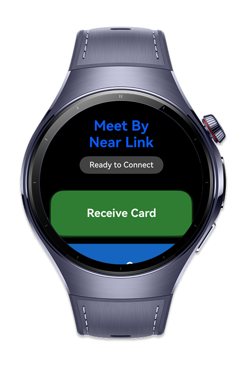
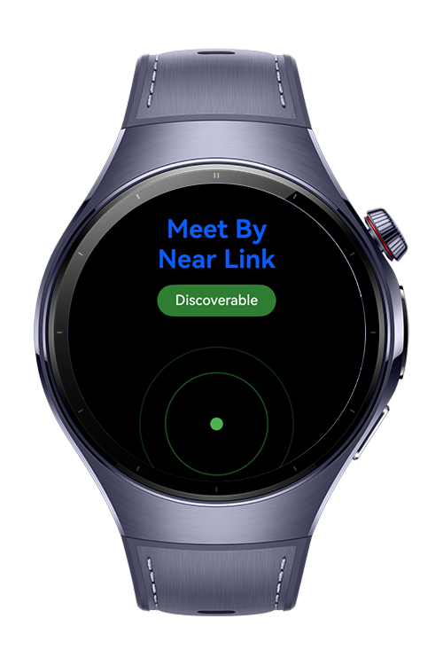
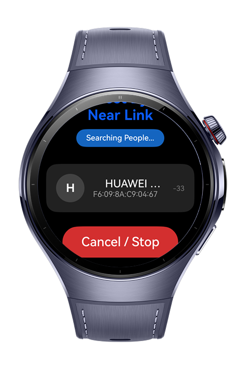
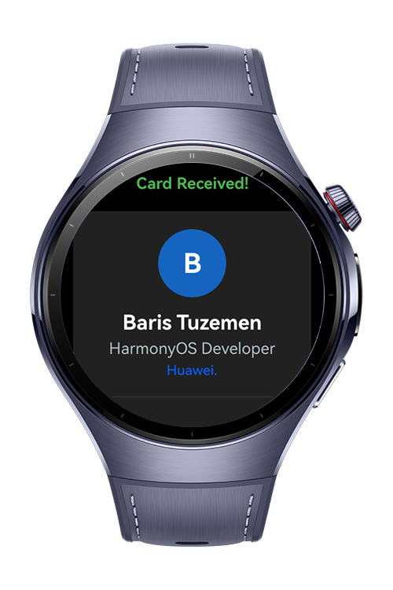

> **Note:** To access all shared projects, get information about environment setup, and view other guides, please visit [Explore-In-HMOS-Wearable Index](https://github.com/Explore-In-HMOS-Wearable/hmos-index).

# MeetByNearLink

MeetByNearLink is a high-performance HarmonyOS wearable application designed for seamless digital business card sharing using NearLink technology. It allows users to instantly discover devices and exchange contact information with ultra-low latency through a sleek, AMOLED-friendly dark interface optimized for smartwatches.

# Preview

<div>
  
  
  
  
</div>

# Use Cases

- **Professional Networking:** At conferences or meetings, users can instantly share their professional identity (Name, Title, Company) without needing physical business cards.

- **Paperless Exchange:** Eliminating paper waste by digitizing contact info and saving received cards directly to the device's memory/contacts.

- **Social Interaction:** Quickly exchanging personal contact details (Phone, Email) with new acquaintances via a simple tap on the wrist.


# Tech Stack

- **Languages**: ArkTS, ArkUI, TypeScript
- **Frameworks**: HarmonyOS SDK 5.1.0(18)
- **Tools**: DevEco Studio Version 5.1.1.823
- **Libraries**:
    - `@kit.AbilityKit`
    - `@kit.PerformanceAnalysisKit`
    - `@kit.ArkUI`
    - `@kit.BasicServicesKit`
    - `@kit.NearLinkKit`
    - `@kit.ArkTS`


# Directory Structure

```
│   module.json5
│
├───ets
│   ├───entryability
│   │       EntryAbility.ets
│   │
│   ├───entrybackupability
│   │       EntryBackupAbility.ets
│   │
│   ├───model
│   │       NearLinkModels.ets
│   │
│   ├───pages
│   │       Index.ets
│   │       NearlinkScanPage.ets
│   │
│   ├───utils
│   │       NearLinkHelper.ets
│   │
│   └───view
│           Components.ets
│
└───resources
    ├───base
    │   ├───element
    │   │       color.json
    │   │       float.json
    │   │       string.json
    │   │
    │   ├───media
    │   │       background.png
    │   │       foreground.png
    │   │       layered_image.json
    │   │       profile.svg
    │   │       startIcon.png
    │   │
    │   └───profile
    │           backup_config.json
    │           main_pages.json
    │
    ├───dark
    │   └───element
    │           color.json
    │
    └───rawfile


```

# Constraints and Restrictions

## Supported Device

* Huawei Watch 5

## Requirements
1. Configure signing settings.
2. Change module.json with your wearable app bundle name.
4. Change watch app bundle name with your bundle name.
5. Add ACCESS_NEARLINK permission

# License

**Meet by Near Link** is distributed under the terms of the MIT License
See the [LICENSE](./LICENSE) for more information.